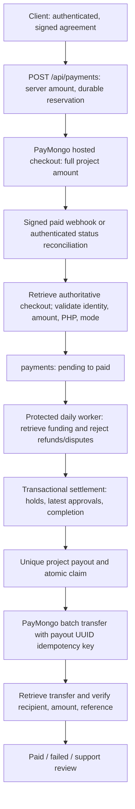

# Payment and payout readiness — 2026-09-30

> Follow-up: separate milestone payouts, 3/7-day delivery review, client auto-accept and cancellation refunds are implemented locally in [milestone-payment-release.md](milestone-payment-release.md). The NEW `202609300004_milestone_settlement.sql` migration is PREPARED, NOT APPLIED. Earlier full-project-only and no-automatic-refund descriptions below are historical. Production readiness is still unverified.

## Post-migration follow-up

The user reports applying `202609300001_payment_readiness.sql`. Subsequent live read-only checks returned HTTP 200 for the previously missing payout tables and settlement timestamp SELECT shapes. OpenAPI now exposes `worksync_settle_project(p_project,p_payment,p_mode)` and `worksync_claim_payout(p_id)` with the expected arguments. This resolves the previously observed missing-object blocker. These checks did not execute either write RPC or independently inspect deployed trigger bodies, grants, or constraints.

Readiness remains **NOT READY** pending configuration and end-to-end validation. Local mode remains test and local settlement remains disabled. Local webhook secret, APP_URL, destination encryption key, payout source configuration and cron secret remain absent; Vercel configuration is unverified. No payment or transfer was created. The audit below preserves the pre-migration findings; its missing-object statements describe that earlier snapshot.

**NOT READY.** Checkout code exists, but neither live collection nor freelancer transfers have been established end to end. Required payout database objects are absent. Local credentials are test-mode and local webhook/payout/scheduler configuration is incomplete. Vercel production configuration was not inspected. No database migration, environment change, provider session, refund, or transfer was made during this audit.

Evidence: application source; user-supplied live `payment_readiness_metadata`; zero-row live Supabase REST/OpenAPI checks; a read-only PayMongo test-key wallets request; local unit tests and an isolated PostgreSQL fixture. These are different levels of evidence, not interchangeable production proof.

## 1. Existing architecture



| Component | Status | Source and boundary |
| --- | --- | --- |
| Hosted checkout/API | IMPLEMENTED; live UNVERIFIED | `app/api/payments/route.ts`, `lib/payments/paymongo.ts`, `services/payments/paymentServer.ts`; authenticated client, both signatures, server budget, durable reservation before provider POST |
| Webhook | IMPLEMENTED; deployed delivery UNVERIFIED | `app/api/payments/webhook/route.ts`; raw-body HMAC, timestamp/mode checks, provider retrieval, retryable persistence errors |
| Payment persistence/reconciliation | IMPLEMENTED; new uniqueness PREPARED | `payments`; one deterministic UUID per project/mode, checkout ID and provider payment ID; return URL alone cannot mark paid |
| Delivery/approval | IMPLEMENTED; automatic path PREPARED | Existing review RPC plus service-only settlement SQL; newest delivery, not a progress note |
| Payout accounts/worker/API | PARTIAL | `app/api/payout-account/route.ts`, `lib/payments/payouts.ts`, `services/payments/settlementServer.ts`; required DB objects MISSING live |
| Scheduler | IMPLEMENTED in source; deployment UNVERIFIED | `app/api/cron/project-settlement/route.ts`, `vercel.json`; daily 00:00 UTC, bearer authentication, explicit enable flag |
| Refunds | MISSING automation; manual process required | Cancellation does not call a provider refund API |

## 2. Already implemented

- Browser cannot supply an amount or payout owner. API validates the Supabase bearer user and project participants. Supabase service credentials stay server-side.
- Checkout reserves a payment primary key before contacting PayMongo. Racing requests cannot independently reserve two sessions. Ambiguous creation failures stay blocked for reconciliation, not blind retry.
- Webhook requires the endpoint secret and mode-specific signature. Authoritative checkout evidence must match project, payer, payment reference, session, PHP amount and mode. Failed attempts do not mark payments paid.
- Settlement re-fetches the provider payment and rejects refunds, disputed payments, or incomplete evidence. Funds are not released merely because a project status says completed.
- Payout destination encryption uses AES-256-GCM. API returns bank label and last four digits. Test/live destinations are separate. Queued payouts snapshot the destination.
- Transfer UUID is both internal reference and provider idempotency key. Claim is durable before sending; ambiguous sends become `needs_review`. Pending transfers are retrieved independently; only matching `succeeded` evidence becomes `paid`.

## 3. Changes made

- Persist PayMongo payment ID, provider, currency, mode and valid provider payment time. Reject conflicting provider IDs and unexpected local payment states; condition payment writes on the existing allowed states.
- Validate a claimed payout against the freshly verified funding and destination before sending. Bound worker processing time to leave room before the route timeout.
- Prepare the single migration below using the supplied live contracts, rather than replaying the older draft. Database fixture execution found that live service orders reject `completed`; settlement now completes project/contract and preserves the converted order lifecycle.
- Require every milestone's latest delivery approval and a total allocation equal to the agreed budget before payout. Claim rechecks signatures, funding, freelancer identity and holds.
- Correct UI wording: full upfront charge including milestone projects, no automatic cancellation refund, no automatic-release promise when disabled.
- Add webhook, provider-ID, funding, ownership and PostgreSQL regression tests; correct scheduler documentation from five-minute to daily.

## 4. Missing and unverified

Live schema lacks `freelancer_payout_accounts`, `project_payouts`, `payments.settlement_checked_at`, `project_submissions.auto_reviewed_at`, `worksync_settle_project`, `worksync_claim_payout`, and `worksync_order_on_hold`. Browser payment writes are already restricted; an equivalent safe table policy was not recreated unnecessarily.

The existing readiness function checks columns but does not prove effective write restrictions or provider-reference uniqueness. Live payment indexes expose only the primary key. Existing provider, mode, currency, payment ID, paid-at and updated-at columns are present and reused.

Verified local configuration has a test PayMongo key and Supabase configuration. Local webhook secret, APP_URL, encryption key, payout source, cron secret and enable flag are absent. These statements do not describe Vercel settings. A read-only `/v2/wallets` returned HTTP 200 with the test key; no wallet contents were printed, and this does not establish live activation, balances or transfer permission.

## 5. Required Supabase migration — prepared only

Review `supabase/migrations/202609300001_payment_readiness.sql`. **Do not run the superseded September 27 draft or indiscriminately replay the migration directory.**

| Change | Reason/security effect |
| --- | --- |
| Two payout tables | Existing app dependencies; accounts keyed by user/mode, payouts unique by project/mode and payment, unique transfer ID; project/payment/user foreign keys; worker index |
| Two timestamps and payment queue index | Rotate funding checks and record automatic approval |
| Provider payment/checkout unique indexes | Prevent the same evidence being attached twice; existing duplicates abort migration, never delete/reassign data |
| Hold and latest-approved-work helpers | Recheck cancellations, disputes, freelancer-authored final work and milestone allocations |
| Settle/claim RPCs | Service-role-only; database transaction/locks, signed contract and payer/recipient/budget/mode checks, one claim before sending |
| Existing contract/submission guard updates | Preserve supplied participant rules; narrowly permit service automatic approval/completion |
| Workflow serialization triggers | Contract lock on project/work/hold mutations; reject mutations after a claimed payout pending support reconciliation |
| Readiness function | Check payment browser write privileges and required valid unique indexes |
| RLS/grants/schema reload | New financial tables RLS enabled with service access only; no new browser policies; existing payment SELECT policies unchanged |

The new table statuses are `awaiting_account`, `ready`, `processing`, `pending`, `paid`, `failed`, `needs_review`. Existing payment status remains `pending`/`paid`; no enum replacement is needed. The migration uses IF NOT EXISTS and CREATE OR REPLACE; applying twice passed the isolated fixture. Unexpected pre-existing incompatible objects or duplicate evidence must be reviewed rather than silently repaired.

Concurrency policy matters: a hold committed first blocks claim. A claim committed first prevents new project/work/resolution mutations and asks for support reconciliation. This preserves safety but means late dispute/cancellation cannot be handled by the normal automatic path. Existing RPC lock orders may cause a deadlock under contention; PostgreSQL rolls back one transaction. Real multi-session staging tests are still required. The fixture does not prove distributed behavior.

## 6. Environment variable names

Server-only: `PAYMONGO_SECRET_KEY`, `PAYMONGO_WEBHOOK_SECRET`, `SUPABASE_SERVICE_ROLE_KEY`, `PAYOUT_ACCOUNT_ENCRYPTION_KEY`, `PAYMONGO_PAYOUT_SOURCE_NUMBER`, `PAYMONGO_PAYOUT_SOURCE_NAME`, `CRON_SECRET`, `PROJECT_SETTLEMENT_ENABLED`.

Configuration: `APP_URL`, `PAYMONGO_PAYMENT_METHODS` (optional, must match merchant capabilities), `NEXT_PUBLIC_SUPABASE_URL`, `NEXT_PUBLIC_SUPABASE_ANON_KEY`. Never put privileged keys in public variables. Keep settlement disabled during deployment preparation. Back up the encryption key securely; rotating it requires destination re-encryption.

## 7. PayMongo actions

- Confirm intended test/live merchant key and enabled checkout methods.
- Register the deployed HTTPS `/api/payments/webhook` for `checkout_session.payment.paid`, with that endpoint's signing secret and matching mode. Inspect actual deliveries and retries.
- Obtain an activated Wallet and the provisioned source account; confirm approved money-movement capability, available funds plus transfer fees, supported destination BIC/network and limits. An API implementation is not merchant activation. See [PayMongo money movement](https://docs.paymongo.com/docs/money-movement-moving-money-with-api).
- Confirm recipient bank details outside simple syntax checks. Saved account ownership is a freelancer declaration, not bank ownership verification.
- Keep ambiguous transfers in support review; provider idempotency retention is limited. Reconcile by internal reference before any retry. See [provider retry guidance](https://docs.paymongo.com/docs/money-movement-best-practices).

## 8. Vercel actions

Configure the matching environment names and redeploy. Verify HTTPS APP_URL and webhook delivery. Confirm `/api/cron/project-settlement` exists in production, `0 0 * * *` is registered and CRON_SECRET is sent as bearer authorization. Source configuration is not proof it runs. Vercel cron can duplicate/overlap and does not automatically retry failures; monitor next-run reconciliation, backlog and error counts. See [cron management](https://vercel.com/docs/cron-jobs/manage-cron-jobs). Leave settlement disabled until staging/provider checks pass and activation is explicitly approved.

## 9. Supabase actions

Back up and review the prepared single migration in staging against current metadata; apply only after review. Test existing participant guards, notifications and contract triggers as well as new RPCs. Confirm browser roles cannot write payments, read encrypted destinations, or call settlement/claim; confirm service-role execution and readiness. Verify no duplicate checkout/payment references before production deployment. No SQL was applied remotely by this audit.

## 10. Manual end-to-end tests

1. Two test participants sign a standard agreement, then a milestone agreement. Charge the full server amount. Verify matching provider checkout/payment IDs and mode; inspect no secrets.
2. Complete test checkout with the browser closed; verify signed webhook persists paid. Repeat delivery, wrong signature, malformed event, failed payment and conflicting identity/amount tests. Confirm one payment and no status regression.
3. Exercise no work, progress-only, latest revision, new superseding work, late submission, seven-day cutoff, every milestone and missing destination. Check notification/completion transaction rollback on injected staging DB failure.
4. Race cancellation/dispute and review against claim with separate real database connections. Run two workers concurrently. Assert one provider send and no held/unpaid/wrong-recipient payout.
5. Check pending, succeeded, failed and ambiguous transfer responses; crash after claim and after send-before-persistence. Reconcile IDs without resending. Change saved destination and verify queued snapshot remains stable.
6. Test anon, unrelated client and unrelated freelancer against API and direct DB; test ciphertext tampering, key absence and test/live isolation.
7. In provider-approved live configuration, perform an explicitly authorized small real collection and payout. Verify provider dashboard, bank receipt, app status and support/refund handling. This audit did not do this.

## 11. Limitations and recovery

- Full project amount upfront; no escrow, installment billing, platform split or automatic refunds. The UI wording search found no affirmative escrow/installment/guaranteed-refund claims in application source.
- Settlement currently supports service-order projects. Job-application projects with no order are skipped; they require a separately reviewed settlement contract before automatic payout is enabled for them.
- Automatic-review cutoff remains `max(submitted_at, min(project_due_date, submitted_at + 7 days))`. Late submissions are immediately eligible. A daily scheduler adds processing delay; there is no guaranteed payout time. Confirm this existing business rule before activation.
- Abandoned/failed checkout stays pending and cannot be blindly recreated. Cancellation before checkout blocks creation. A previously issued hosted checkout may remain payable; later receipts require support reconciliation. Cancellation after payment does not refund it. Disputes/refunds block payout when independently checked. After claim or payout, cancellation/refund/recovery is a support operation.
- Provider refund/chargeback can race the gap between provider verification and transfer; no database lock spans PayMongo. Operational holds, reconciliation and merchant reserves remain necessary.
- No bank ownership verification, production dashboard inspection, provider transfer, browser end-to-end run or live permission impersonation was performed. Payment statuses do not model refunds; do not treat `paid` as proof no later refund occurred. Admin transaction reporting must not interpret test payments as collected revenue.
- Recovery is intentionally manual after ambiguous or failed transfer. Never reset a payout to ready until provider records and destination/amount are reconciled and a retry is explicitly authorized.

## 12. Validation and decision

Readiness: **NOT READY**. Missing live database objects and unverified production configuration/provider behavior prevent either test-mode-ready or production-configuration-ready classification.

Local validation results are recorded after execution below. PostgreSQL tests use a reduced fixture derived from supplied types, defaults and checks; unrelated FKs/triggers and required-column constraints are omitted, and participant helpers are stubs. It is not a clone of Supabase and does not prove RLS across real signed-in accounts.

- TypeScript: passed (`pnpm.cmd typecheck`).
- Targeted ESLint: passed for changed payment implementation, tests and audit script.
- Payment/settlement/PostgreSQL tests: 42 passed, zero failed; migration applied twice inside the fixture.
- Full suite: 191 tests, 184 passed, 7 failed. Existing failures are marketplace identity cache mocks (1), messaging history cache mocks (3), calendar cache mock (1), portfolio cache/module mocks (2). They remain outside this payment change; the full suite is not green.
- Production build, browser flow, real Supabase write/concurrency tests and live provider money movement: not run.

The repository currently ignores `docs/`; this handoff exists locally but must be explicitly included in any shared handoff or commit if desired. The migration and test sources are not ignored.

To run the isolated database tests without changing application dependencies:

```powershell
npm.cmd install --prefix .next/payment-audit/runtime @electric-sql/pglite --ignore-scripts --no-audit --no-fund
node --test tests/payment-readiness-sql.test.cjs tests/payments.test.cjs tests/project-settlement.test.cjs
```

Without the optional local runtime, the SQL test explicitly skips. `scripts/payment-readiness-readonly.cjs` reports redacted configuration presence and read-only dependency checks; it does not create checkout or send money.
